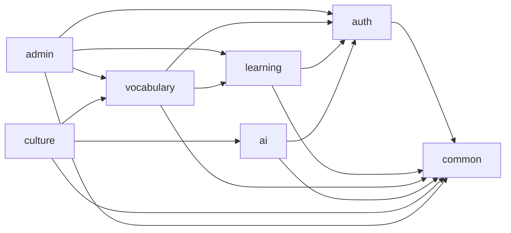

# Backend architecture

Backend is organized as a package-by-feature modular monolith. `BackendApplication` stays in
`com.sep490.backend`, so Spring still discovers every component, entity, and repository below
`common` and `modules`.

## Package ownership

```text
com.sep490.backend
├── common
│   ├── config          # Database and infrastructure properties
│   ├── dto             # Shared API contracts
│   ├── exception       # Cross-cutting error handling
│   ├── media           # Shared media adapter
│   └── security        # Shared principal and authorization contracts
├── modules
│   ├── auth            # Authentication, users, roles, profiles, notifications
│   ├── learning        # Courses, lessons, activities, quizzes, progress, seeds
│   ├── vocabulary      # Dictionary, personal notebook, and SRS review
│   ├── ai              # Tutor, roleplay, provider adapters, usage tracking
│   ├── culture         # Destinations and regional Vietnamese
│   └── admin
│       ├── cms         # Banner, menu, and feature-flag management
│       ├── importing   # Excel and website import adapters
│       └── media       # Administrative upload endpoints
└── BackendApplication.java
```

Admin-facing controllers for AI, culture, learning, and vocabulary remain inside the module that
owns the business rule. The `admin` module contains only cross-domain administration, CMS, import,
and media orchestration. Java reserves the word `import`, so the source package is named
`admin.importing`.

## Dependency direction



`common` never imports a feature module. Two ports remove otherwise circular dependencies:

- `auth.port.LearnerProfileUseCase` is implemented by the learning module.
- `learning.port.VocabularyProgressReader` is implemented by the vocabulary module.

The architecture test verifies package/path consistency, rejects legacy top-level layer packages,
prevents `common -> modules` imports, and detects cycles between feature modules.

## Change rules

1. Put a new use case in the module that owns its business rule, including its controller, service,
   DTO, entity, repository, and mapper.
2. Put only technical, stable contracts in `common`; do not use it as a miscellaneous folder.
3. When one module needs data from another, depend on a narrow public service/port instead of
   reaching into another module's internal implementation.
4. Keep admin variants of a domain endpoint in that domain (for example
   `vocabulary.controller.admin`), unless the use case truly orchestrates several modules.
