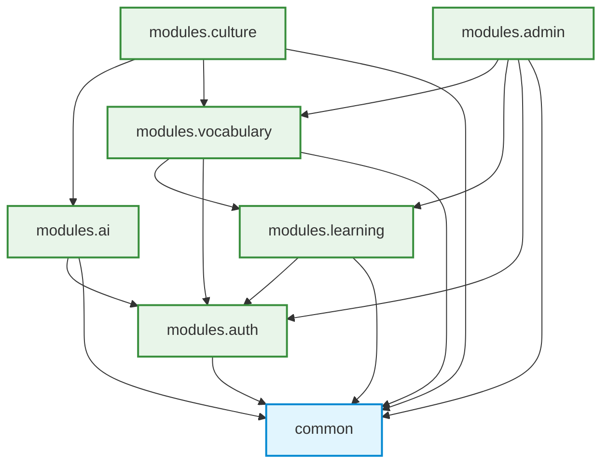

# BÁO CÁO KIẾN TRÚC MÃ NGUỒN (CODE ARCHITECTURE REPORT)
## Dự án: Hola Vietnamese Backend (com.sep490.backend)

---

## 1. TỔNG QUAN VỀ PHONG CÁCH KIẾN TRÚC (ARCHITECTURAL STYLE)

### 1.1. Mô hình lựa chọn: Modular Monolith (Package-by-Feature)
Hệ thống Backend Hola Vietnamese được thiết kế theo mô hình **Modular Monolith**, áp dụng triết lý **Package-by-Feature** kết hợp kiến trúc phân tầng nội bộ (**Layered Architecture** bên trong mỗi domain):

* **Ngôn ngữ & Nền tảng:** Java 21, Spring Boot 3.3.x, MySQL 8.4, Flyway Database Migration.
* **Lý do lựa chọn:**
  1. **Tối ưu hiệu năng & đơn giản hóa triển khai:** Tránh được chi phí overhead về mạng (network latency), serialized/deserialized dữ liệu và quản lý giao dịch phân tán (distributed transactions) của Microservices trong giai đoạn hiện tại.
  2. **Ranh giới nghiệp vụ độc lập (High Cohesion, Low Coupling):** Mỗi module sở hữu trọn vẹn nghiệp vụ (Controller -> Service -> Repository -> Entity/DTO), giúp các thành viên nhóm làm việc song song mà không xung đột mã nguồn.
  3. **Khả năng mở rộng trong tương lai:** Nếu tải hệ thống tăng cao (ví dụ: module AI hoặc Learning cần mở rộng độc lập), ranh giới rõ ràng cho phép bóc tách thành các Microservices riêng biệt mà không cần tái cấu trúc nghiệp vụ.

---

### 1.2. Cấu trúc thư mục & Quyền sở hữu Module (Package Ownership)

```text
com.sep490.backend
├── common                      # Lớp hạ tầng và hợp đồng kỹ thuật dùng chung
│   ├── config                  # Cấu hình Database, Flyway, Cloudinary...
│   ├── dto                     # ApiResponse chuẩn, PageResponse, Pagination
│   ├── entity                  # BaseEntity (createdAt, updatedAt, id...)
│   ├── exception               # GlobalExceptionHandler, AppException, ErrorCode
│   ├── media                   # Adapter tải lên/xử lý Cloudinary
│   └── security                # JWT Provider, LearnerPrincipal, SecurityFilter
├── modules                     # Các module nghiệp vụ lõi (Feature Modules)
│   ├── auth                    # Xác thực, User, Role, Profile, OTP, Notification
│   ├── learning                # Khóa học, bài học, hoạt động, quiz, tính toán tiến độ
│   ├── vocabulary              # Từ điển song ngữ, Sổ tay cá nhân, Thuật toán SRS
│   ├── ai                      # AI Tutor, Roleplay hội thoại, Provider Adapter, Token Usage
│   ├── culture                 # Khám phá văn hóa, Điểm đến, Phương ngữ vùng miền
│   └── admin                   # CMS tổng hợp, Excel Import Orchestration, Quản trị Media
└── BackendApplication.java     # Root Application Launcher
```

---

### 1.3. Biểu đồ phụ thuộc & Cơ chế chống phụ thuộc vòng (Acyclic Dependencies)

Hệ thống tuân thủ nghiêm ngặt đồ thị phụ thuộc một chiều (**DAG - Directed Acyclic Graph**):



#### Các nguyên tắc bất biến (Invariants):
1. **`common` là tầng độc lập:** Tuyệt đối không import bất kỳ package nào thuộc `modules.*`.
2. **Ports & Dependency Inversion:** Để giải quyết các nhu cầu đọc dữ liệu chéo mà không sinh ra vòng lặp (circular dependency), hệ thống sử dụng các Port Interface:
   * `auth.port.LearnerProfileUseCase` được hiện thực bởi module `learning`.
   * `learning.port.VocabularyProgressReader` được hiện thực bởi module `vocabulary`.
3. **Kiểm thử kiến trúc tự động (Architecture-as-Code):**
   * Class `ArchitectureStructureTests` được tích hợp trong bộ test suite để tự động quét toàn bộ cây thư mục mã nguồn:
     - Bắt buộc mọi class production phải nằm trong `common` hoặc `modules.<tên_module>`.
     - Chặn các import vi phạm từ `common` sang `modules`.
     - Dùng thuật toán Topological Sort để phát hiện ngay lập tức nếu xuất hiện chu trình (cycle) giữa các module.

---

## 2. PHÂN TÍCH CHUYÊN SÂU SEQUENCE DIAGRAM: "AI TUTOR CONVERSATION WITH PROVIDER ROUTING"

Đây là luồng nghiệp vụ phức tạp và đại diện tiêu biểu nhất cho khả năng thiết kế chịu lỗi, bảo mật đa người dùng và tích hợp AI linh hoạt của hệ thống.

```mermaid
sequenceDiagram
    autonumber
    actor User as Learner / User
    participant UI as AI Tutor UI
    participant Ctrl as AiTutorController
    participant Svc as AiTutorService
    participant Provider as AiProviderService
    participant Client as OpenAI / Gemini Client
    participant DB as MySQL Database

    rect rgb(240, 248, 255)
    Note over User, DB: 1. Khởi tạo phiên hội thoại (Start Conversation)
    User->>UI: Bắt đầu phiên trò chuyện
    UI->>Ctrl: POST /api/ai/sessions
    Ctrl->>Svc: createSession(request)
    Svc->>Svc: Xác thực User, nạp Settings, kiểm tra Daily Quota (BR-24)
    Svc->>DB: Lưu bản ghi AiSession (ACTIVE) và Initial Greeting
    DB-->>Svc: Persisted AiSession
    Svc-->>Ctrl: AiSessionResponse
    Ctrl-->>UI: 200 OK (AiSessionResponse)
    end

    rect rgb(255, 250, 240)
    Note over User, DB: 2. Gửi tin nhắn và Định tuyến AI (Ask a Question)
    User->>UI: Gửi câu hỏi / đoạn chat
    UI->>Ctrl: POST /api/ai/sessions/{id}/messages
    Ctrl->>Svc: sendMessage(sessionId, request)
    Svc->>DB: Tìm session theo sessionId & currentUserId
    
    alt Người dùng khác cố tình truy cập (Ownership Check)
        Svc-->>Ctrl: throw AppException(ErrorCode.UNAUTHORIZED)
        Ctrl-->>UI: 403 Forbidden ("Do not meddle with the other user's conversation")
    else Đúng chủ sở hữu và Session đang ACTIVE
        Svc->>DB: Lưu tin nhắn người dùng (sender="user")
        Svc->>Svc: 1. IntentClassifier phân loại ý định<br/>2. Cập nhật context_summary (working memory)<br/>3. Build System Prompt cá nhân hóa theo Level & Goal
        
        Svc->>Provider: generateMultiTurn(systemPrompt, contents, model)
        
        alt Model được cấu hình OpenAI / LLaMA / Anthropic
            Provider->>Client: OpenAiApiClient.generateAiTutor(...)
        else Model Google Gemini
            Provider->>Client: GeminiApiClient.generateAiTutor(...)
        end

        alt Provider phản hồi hợp lệ (Success)
            Client-->>Provider: Text response + Token usage + Latency
            Provider-->>Svc: GeminiResponse
            Svc->>Svc: parseAndBuildAiMessage(...)
        else Lỗi mạng / Hết quota / Thiếu API Key (Fallback)
            Provider-->>Svc: null / exception
            Svc->>Svc: generateOfflineTutorResponse(...) (Rule-based + Context-aware)
        end

        Svc->>DB: Giao dịch đơn nhất (@Transactional):<br/>- Lưu AiMessage của AI<br/>- Tăng turnsCount, update session timestamp<br/>- Ghi log AiUsageLog (UC-108)
        Svc-->>Ctrl: AiMessageResponse
        Ctrl-->>UI: 200 OK (AiMessageResponse)
    end
    end

    rect rgb(240, 255, 240)
    Note over User, DB: 3. Kết thúc phiên hội thoại (End Session)
    UI->>Ctrl: POST /api/ai/sessions/{id}/end
    Ctrl->>Svc: endSession(id)
    Svc->>DB: findByIdAndUserId; cập nhật status="COMPLETED", endedAt, feedbackSummary
    DB-->>Svc: Updated Session
    Svc-->>Ctrl: Completed session summary
    Ctrl-->>UI: 200 OK (Summary Response)
    end
```

---

### 2.1. Chi tiết các thành phần trong sơ đồ

#### Thành phần 1: `AiTutorController`
* **Nhiệm vụ:** Tầng giao tiếp REST API, nhận HTTP request từ Client, thực hiện validation tự động với `@Valid`, định tuyến vào Service và bọc response theo định dạng `ApiResponse<T>` đồng nhất.
* **Các Endpoint chính:**
  * `POST /api/ai/sessions`: Tạo phiên học gia sư AI mới.
  * `POST /api/ai/sessions/{id}/messages`: Gửi tin nhắn và nhận phản hồi gia sư.
  * `POST /api/ai/sessions/{id}/end`: Đóng phiên học và nhận đánh giá tổng quan.

#### Thành phần 2: `AiTutorService` (Trái tim nghiệp vụ)
* **Xác thực bảo mật & Phân quyền dữ liệu (Multi-tenancy Isolation):**
  * Sử dụng phương thức `resolveUserSessionId(...)` và truy vấn `sessionRepository.findByIdAndUserId(sessionId, userId)`.
  * Nếu một người dùng cố tình gửi tin nhắn vào `sessionId` của người khác, hệ thống chặn ngay và trả về mã lỗi `ErrorCode.UNAUTHORIZED` (HTTP 403 Forbidden).
* **Quản lý hạn ngạch (Daily Session Quota - BR-24):** Kiểm tra số phiên học trong ngày dựa trên thời gian bắt đầu `LocalDate.now().atStartOfDay()` để tránh lạm dụng tài nguyên.
* **Xử lý ngữ cảnh thông minh (Context Engineering & Memory):**
  1. **Intent Classification (`IntentClassifier`):** Phân tích câu nói của học viên thuộc nhóm nào: `PRONUNCIATION`, `VOCABULARY`, `TRANSLATION`, `GRAMMAR_CORRECTION`, `PRACTICE`, hay `CASUAL_CHAT`.
  2. **Working Memory (`context_summary`):** Tự động tóm tắt ngữ cảnh hội thoại trước đó để truyền vào prompt, giúp AI nhớ bối cảnh mà không bị tràn token context window.
  3. **Personalized System Prompt:** Điều chỉnh giọng điệu và độ khó câu trả lời theo trình độ người học (`A1, A2, B1...`), ngôn ngữ mẹ đẻ và mục tiêu học tập.

#### Thành phần 3: `AiProviderService` (Mẫu thiết kế Strategy & Adapter)
* **Nhiệm vụ:** Đóng vai trò là cổng định tuyến (Gateway/Router) giữa hệ thống Backend và các nhà cung cấp mô hình ngôn ngữ lớn (LLMs).
* **Định tuyến linh hoạt (Provider Routing):**
  * Hàm `isOpenAiModel(model)` kiểm tra tiền tố: `gpt-*`, `openrouter/*`, `anthropic/*`, `meta-llama/*` -> điều hướng gọi `OpenAiApiClient`.
  * Các model còn lại (`gemini-*`) -> điều hướng gọi `GeminiApiClient`.
* **Lợi ích kiến trúc:** Tách rời hoàn toàn nghiệp vụ AI Tutor khỏi SDK cụ thể của Google hay OpenAI. Khi muốn đổi model, chỉ cần thay đổi cấu hình mà không sửa bất kỳ dòng code nghiệp vụ nào trong `AiTutorService`.

#### Thành phần 4: Cơ chế Chịu lỗi & Phục hồi (Graceful Degradation / Fallback)
* Nếu nhà cung cấp AI gặp sự cố (mất mạng, timeout, hết quota, hoặc admin chưa cấu hình API Key):
  * `AiProviderService` trả về `null` thay vì làm sập luồng (throw exception 500).
  * `AiTutorService` lập tức kích hoạt bộ phản hồi offline: `generateOfflineTutorResponse(...)`.
  * Bộ fallback này sử dụng intent đã phân loại, kho từ điển có sẵn và ngữ cảnh câu hỏi để tạo câu phản hồi tự nhiên, giải thích ngữ pháp hoặc dịch câu đúng mực. Học viên không bao giờ bị gián đoạn trải nghiệm học tập.

#### Thành phần 5: Toàn vẹn giao dịch & Giám sát chi phí (Transaction & Auditing)
* Toàn bộ các bước: Lưu tin nhắn AI, tăng `turnsCount`, cập nhật thời gian phiên và ghi nhật ký sử dụng `AiUsageLog` (ghi nhận tokens in, tokens out, latency ms, http status) được đóng gói trong một transaction duy nhất với `@Transactional`.

---

## 3. CÁC NGUYÊN LÝ & DESIGN PATTERNS NỔI BẬT

| STT | Design Pattern / Nguyên lý | Vị trí áp dụng cụ thể trong Code | Giá trị mang lại |
|:---:|:---|:---|:---|
| 1 | **Strategy Pattern** | `AiProviderService` định tuyến giữa `GeminiApiClient` và `OpenAiApiClient` | Cho phép tráo đổi linh hoạt nhiều nhà cung cấp AI tại runtime mà không ảnh hưởng code nghiệp vụ. |
| 2 | **Adapter Pattern** | `GeminiApiClient` & `OpenAiApiClient` chuẩn hóa request/response bên ngoài về DTO nội bộ `GeminiResponse` | Cách ly dữ liệu ngoài, bảo vệ core domain không bị phụ thuộc vào API bên thứ 3. |
| 3 | **Port & Adapter (Hexagonal Lite)** | `LearnerProfileUseCase`, `VocabularyProgressReader` | Triệt tiêu hoàn toàn vòng lặp phụ thuộc (circular dependency) giữa các domain package. |
| 4 | **Fallback / Graceful Degradation** | `generateOfflineTutorResponse` trong `AiTutorService` | Đảm bảo tính sẵn sàng cao (High Availability), hệ thống không sập khi bên thứ 3 gặp lỗi. |
| 5 | **Data-level Authorization Pattern** | `sessionRepository.findByIdAndUserId(...)` | Ngăn chặn triệt để lỗ hổng IDOR (Insecure Direct Object Reference) trong các phiên chat cá nhân. |
| 6 | **Architecture-as-Code** | `ArchitectureStructureTests` với JUnit 5 | Tự động hóa kiểm soát kiến trúc trong quy trình CI/CD, không cho phép code vi phạm ranh giới module được merge. |

---

## 4. KỊCH BẢN THUYẾT TRÌNH BÁO CÁO (PRESENTATION SCRIPT)

*(Dành cho bạn nói trực tiếp trước Hội đồng / Tech Lead trong vòng 5 - 7 phút)*

### Lời mở đầu (30 giây)
> *"Kính thưa Thầy Cô / Anh Chị, hôm nay em xin đại diện nhóm báo cáo về **Kiến trúc mã nguồn Backend của dự án Hola Vietnamese**. Hệ thống backend được xây dựng trên nền tảng **Java 21, Spring Boot 3 và cơ sở dữ liệu MySQL 8.4**, được thiết kế với mục tiêu cốt lõi: **Độ ổn định cao, phân tách nghiệp vụ mạch lạc và dễ dàng bảo trì mở rộng**."*

### Phần 1: Kiến trúc tổng thể & Cấu trúc mã nguồn (1.5 phút)
> *"Về phong cách kiến trúc, nhóm lựa chọn mô hình **Modular Monolith** theo triết lý **Package-by-Feature**:*
> * *Thay vì chia tầng ngang truyền thống làm cho code bị phân tán, nhóm gom toàn bộ mã nguồn theo miền nghiệp vụ: gồm tầng `common` độc lập và 6 module chính: `auth`, `learning`, `vocabulary`, `ai`, `culture`, và `admin`.*
> * *Tất cả các module phụ thuộc một chiều hướng về `common`, và đặc biệt **không có phụ thuộc vòng** giữa các module chức năng. Khi module `auth` cần dữ liệu học tập, chúng em sử dụng **Port Interface** như `LearnerProfileUseCase` để đảo ngược phụ thuộc.*
> * *Điểm đặc biệt là kiến trúc này được bảo vệ bằng kiểm thử tự động `ArchitectureStructureTests`. Bất kỳ lập trình viên nào vô tình import sai quy tắc hay gây ra circular dependency, test case sẽ chặn đứng ngay tại bước build.*"

### Phần 2: Phân tích sâu luồng AI Tutor & Provider Routing (2.5 phút) - **(Chiếu sơ đồ Sequence Diagram)**
> *"Để minh họa rõ nét nhất cách các tầng và module phối hợp, em xin trình bày luồng nghiệp vụ **AI Tutor Conversation with Provider Routing** qua sơ đồ Sequence Diagram trên màn hình:*
>
> 1. *Đầu tiên, khi học viên bắt đầu phiên học (`POST /api/ai/sessions`), `AiTutorService` kiểm tra hạn ngạch hàng ngày (Daily Quota) của tài khoản và tạo một phiên `ACTIVE` cùng câu chào khởi đầu vào cơ sở dữ liệu.*
> 2. *Khi học viên gửi tin nhắn (`POST /api/ai/sessions/{id}/messages`), hệ thống thực hiện 4 bước xử lý chuyên sâu:*
>    * *Thứ nhất là **Bảo mật**: Service kiểm tra quyền sở hữu phiên. Nếu một user khác cố tình can thiệp vào session ID này, hệ thống chặn ngay và trả về **403 Forbidden**.*
>    * *Thứ hai là **Xử lý ngữ cảnh**: Tin nhắn người dùng được lưu lại. Lớp `IntentClassifier` sẽ phân loại ý định người học (hỏi phát âm, sửa ngữ pháp, dịch từ hay trò chuyện tự nhiên). Hệ thống nạp bộ nhớ làm việc `context_summary` và hồ sơ người học (trình độ A1/A2, mục tiêu) để xây dựng System Prompt cá nhân hóa.*
>    * *Thứ ba là **Định tuyến nhà cung cấp AI linh hoạt (Provider Routing)**: Qua `AiProviderService`, hệ thống tự động nhận biết model đang cấu hình là OpenAI/LLaMA hay Gemini để gọi đúng API Client tương ứng.*
>    * *Thứ tư là **Cơ chế Chịu lỗi (Fallback)**: Nếu phía AI bên ngoài phản hồi tốt, kết quả kèm số lượng token tiêu thụ và độ trễ sẽ được lưu lại. Trường hợp mạng lỗi, hết quota API hoặc chưa cấu hình key, hệ thống kích hoạt ngay hàm `generateOfflineTutorResponse`. Bộ phản hồi offline dựa trên intent và từ điển nội bộ sẽ trả về câu trả lời hợp lý, giúp trải nghiệm của học viên không bao giờ bị đứt đoạn.*
> 3. *Tất cả các thao tác lưu tin nhắn AI, tăng số lượt trao đổi (turnsCount) và ghi nhật ký giám sát `AiUsageLog` đều được quản lý trọn vẹn trong một giao dịch đơn nhất `@Transactional`.*
> 4. *Cuối cùng, khi học viên hoàn tất buổi học, hệ thống đóng phiên với trạng thái `COMPLETED` và trả về bảng tổng kết tóm tắt quá trình luyện tập.*"

### Lời kết (30 giây)
> *"Nhờ kiến trúc Modular Monolith vững chắc kết hợp các mẫu thiết kế Strategy và Fallback, hệ thống Hola Vietnamese Backend vừa đảm bảo tính bảo mật, hiệu năng truy vấn nhanh, vừa đạt độ sẵn sàng cao khi làm việc với các dịch vụ AI bên ngoài. Em xin chân thành cảm ơn và sẵn sàng lắng nghe câu hỏi từ Thầy Cô / Anh Chị!"*

---

## 5. BỘ CÂU HỎI PHẢN BIỆN THƯỜNG GẶP (Q&A DEFENSE PREPARATION)

### Câu hỏi 1: Tại sao nhóm không chọn kiến trúc Microservices ngay từ đầu mà lại dùng Modular Monolith?
* **Đáp án chuẩn:**
  * Microservices phù hợp khi có nhiều đội phát triển độc lập (hàng chục/hàng trăm kỹ sư) quản lý các service riêng biệt và cần scale độc lập về mặt hạ tầng.
  * Với quy mô hiện tại của dự án, Modular Monolith đem lại lợi thế tối thượng: **Triển khai đơn giản (Single Deployment Unit)**, **kiểm soát toàn vẹn dữ liệu qua Transaction cục bộ**, **không bị độ trễ mạng giữa các service**, và **dễ dàng gỡ lỗi (debug)**.
  * Nhóm đã phân tách ranh giới các module rất chặt chẽ (Package-by-Feature, Acyclic Dependencies). Do đó, trong tương lai nếu module AI hoặc Học tập cần tách thành Microservice, việc bóc tách chỉ là đưa module đó ra một repo mới mà không phải đập đi xây lại logic nghiệp vụ.

---

### Câu hỏi 2: Trong sơ đồ Sequence Diagram, nếu API của OpenAI hoặc Gemini bị timeout hoặc nghẽn mạng thì người dùng có bị treo request hay nhận lỗi 500 không?
* **Đáp án chuẩn:**
  * **Hoàn toàn không.** Hệ thống đã thiết kế theo nguyên lý **Graceful Degradation (Suy thoái mềm)**.
  * Trong `AiProviderService` và các Client, request gọi ra ngoài đều có cấu hình timeout rõ ràng. Khi xảy ra ngoại lệ mạng hoặc không nhận được response, hệ thống không để exception bắn thẳng ra Controller mà trả về `null`.
  * Tại `AiTutorService`, khi kết quả AI là `null`, luồng xử lý tự động kích hoạt `generateOfflineTutorResponse(...)`. Hàm này sử dụng `IntentClassifier` và cơ sở dữ liệu từ điển/mẫu câu có sẵn để tạo phản hồi có nghĩa cho học viên với mã HTTP 200, đảm bảo tính sẵn sàng (High Availability).

---

### Câu hỏi 3: Làm thế nào hệ thống ngăn chặn một người dùng A đọc lén hoặc chat vào phiên AI của người dùng B (Lỗ hổng IDOR)?
* **Đáp án chuẩn:**
  * Hệ thống áp dụng **Kiểm soát truy cập mức dữ liệu (Data-level Authorization)**.
  * Khi Controller nhận request, thông tin định danh `userId` được trích xuất an toàn từ `LearnerPrincipal` trong Spring `SecurityContextHolder` (được giải mã từ JWT token hợp lệ, không phụ thuộc vào tham số client gửi lên).
  * Trong Service, câu lệnh truy vấn luôn là `sessionRepository.findByIdAndUserId(sessionId, currentUser.getId())`. Nếu session tồn tại nhưng thuộc sở hữu của người khác, truy vấn sẽ không khớp hoặc logic `resolveUserSessionId` sẽ phát hiện sự sai lệch chủ sở hữu và ném ngay ngoại lệ `AppException(ErrorCode.UNAUTHORIZED)`, trả về mã **HTTP 403 Forbidden**.

---

### Câu hỏi 4: Tại sao cần có `IntentClassifier` và `context_summary` trước khi gửi tin nhắn cho mô hình AI?
* **Đáp án chuẩn:**
  * **IntentClassifier:** Người học ngoại ngữ có nhiều mục đích giao tiếp khác nhau (hỏi phát âm, dịch câu, bắt lỗi ngữ pháp hay trò chuyện tự do). Việc nhận diện trước ý định giúp hệ thống tinh chỉnh `System Instruction` chuẩn xác, hướng dẫn AI phản hồi đúng trọng tâm thay vì lúc nào cũng biến cuộc hội thoại thành bài giảng ngữ pháp gượng gạo.
  * **context_summary:** Các mô hình LLM tính phí và bị giới hạn bởi số lượng token đầu vào (Context Window). Bằng cách duy trì một bản tóm tắt ngữ cảnh (`context_summary`), hệ thống chỉ cần gửi bản tóm tắt kèm vài tin nhắn gần nhất thay vì gửi toàn bộ lịch sử hàng chục tin nhắn cũ, vừa **tiết kiệm chi phí token**, vừa **giảm độ trễ phản hồi (latency)**.

---

### Câu hỏi 5: Hệ thống làm thế nào để đảm bảo chất lượng kiến trúc không bị biến dạng khi nhiều lập trình viên cùng thêm tính năng mới?
* **Đáp án chuẩn:**
  * Nhóm đã hiện thực hóa nguyên lý **Architecture-as-Code** thông qua class `ArchitectureStructureTests` sử dụng JUnit 5.
  * Test case này sẽ quét cây thư mục mã nguồn và tự động đánh trượt (fail build) trong pipeline CI/CD nếu phát hiện:
    1. Có file code mới đặt sai quy chuẩn thư mục (ví dụ tự tiện tạo package layer ở root).
    2. Package `common` xuất hiện lệnh import ngược vào bất kỳ `modules.*` nào.
    3. Xuất hiện mối quan hệ phụ thuộc vòng giữa các feature module.
  * Nhờ vậy, quy tắc kiến trúc được cưỡng chế tự động bằng máy móc chứ không chỉ dựa vào quy ước miệng.
