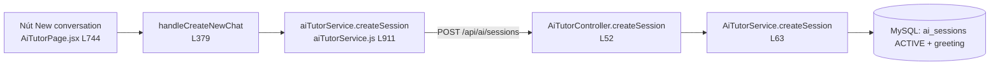
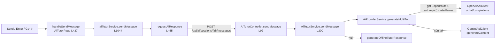

# Demo luồng AI Tutor: từ nút bấm FE đến BE (theo Sequence Diagram)

> [!NOTE]
> FE: `D:\holavietnamese_fe` (React + Vite) · BE: `D:\holavietnamese-be` (Spring Boot).
> FE gọi BE qua `axiosClient` với `baseURL = VITE_API_BASE_URL = http://localhost:8088` và tự gắn `Authorization: Bearer <token>`.

## 0. Cầu nối FE → BE

| Bước | Mở file | Nói gì |
|---|---|---|
| Route | [routes.js#L67](file:///D:/holavietnamese_fe/src/constants/routes.js#L67) → [AppRouter.jsx#L180](file:///D:/holavietnamese_fe/src/app/router/AppRouter.jsx#L180) | URL `/ai-tutor` render `AiTutorPage` |
| HTTP client | [axiosClient.js#L3-L45](file:///D:/holavietnamese_fe/src/shared/api/axiosClient.js#L3-L45) | Base URL + interceptor gắn JWT → BE biết user hiện tại là ai |

**Mẹo khi demo:** IDE không Ctrl+Click được từ FE sang BE. Phần nối hai bên chính là **chuỗi URL**. Hãy copy đường dẫn (ví dụ `/sessions/{id}/messages`) rồi nhấn `Ctrl+Shift+F` trong project BE để nhảy tới `@PostMapping`. Bạn cũng có thể mở **DevTools → Network** để cho thấy request thật.

---

## ① "Start a conversation": nút **Cuộc trò chuyện mới**

| # | Click/mở | Code | Ứng với mũi tên trong diagram |
|---|---|---|---|
| 1 | Nút **New conversation** | [AiTutorPage.jsx#L742-L750](file:///D:/holavietnamese_fe/src/features/ai/pages/ai-tutor/AiTutorPage.jsx#L742-L750) | User → UI "Start a conversation" |
| 2 | Handler | [`handleCreateNewChat`](file:///D:/holavietnamese_fe/src/features/ai/pages/ai-tutor/AiTutorPage.jsx#L379-L392) | |
| 3 | Service FE | [`createSession`](file:///D:/holavietnamese_fe/src/features/ai/api/aiTutorService.js#L911-L956): sinh id `session-{timestamp}-{user}`, gọi **`POST /api/ai/sessions`** ([L938-L941](file:///D:/holavietnamese_fe/src/features/ai/api/aiTutorService.js#L938-L941)) | UI → Controller `POST /api/ai/sessions` |
| 4 | **→ Sang BE** Controller | [`AiTutorController.createSession`](file:///D:/holavietnamese-be/src/main/java/com/sep490/backend/modules/ai/controller/AiTutorController.java#L52-L59) | Controller → Service `createSession(request)` |
| 5 | Service BE | [`AiTutorService.createSession`](file:///D:/holavietnamese-be/src/main/java/com/sep490/backend/modules/ai/service/AiTutorService.java#L63-L118): `getCurrentUser()` lấy user từ JWT, đọc settings, kiểm tra quota trong ngày ([L68-L73](file:///D:/holavietnamese-be/src/main/java/com/sep490/backend/modules/ai/service/AiTutorService.java#L68-L73)) | "Resolve current user, load settings, check daily quota" |
| 6 | Lưu DB | `sessionRepository.save` + lời chào `messageRepository.save` ([L92-L117](file:///D:/holavietnamese-be/src/main/java/com/sep490/backend/modules/ai/service/AiTutorService.java#L92-L117)) | "Save owned ACTIVE AI session and initial greeting" → trả `AiSessionResponse` |

---

## ② "Ask a question": nút **Gửi**, phím Enter hoặc chip **Gợi ý**

### Phía FE

| # | Click/mở | Code |
|---|---|---|
| 1 | Nút **Send** (type=submit) | [AiTutorPage.jsx#L1365](file:///D:/holavietnamese_fe/src/features/ai/pages/ai-tutor/AiTutorPage.jsx#L1365) `<form onSubmit={handleSubmit}>` và [nút Send L1401-L1413](file:///D:/holavietnamese_fe/src/features/ai/pages/ai-tutor/AiTutorPage.jsx#L1401-L1413) |
| 1' | Enter / chip gợi ý | [`handleKeyDown` L470](file:///D:/holavietnamese_fe/src/features/ai/pages/ai-tutor/AiTutorPage.jsx#L470-L475) · [chip L1355](file:///D:/holavietnamese_fe/src/features/ai/pages/ai-tutor/AiTutorPage.jsx#L1352-L1360) |
| 2 | Handler | [`handleSendMessage`](file:///D:/holavietnamese_fe/src/features/ai/pages/ai-tutor/AiTutorPage.jsx#L437-L468): bật `isSending`, gọi service, cập nhật state |
| 3 | Service FE | [`sendMessage`](file:///D:/holavietnamese_fe/src/features/ai/api/aiTutorService.js#L1044-L1173): **chờ request tạo session xong** (`pendingSessionCreations`, L1059) rồi gửi, thử lại tối đa 2 lần |
| 4 | HTTP | [`requestAiResponse`](file:///D:/holavietnamese_fe/src/features/ai/api/aiTutorService.js#L455-L473): **`POST /api/ai/sessions/${sessionId}/messages`**, body `{text, mode, language}`, timeout 60s |

### **→ Sang BE**

| # | Mở | Code | Diagram |
|---|---|---|---|
| 5 | Controller | [`AiTutorController.sendMessage`](file:///D:/holavietnamese-be/src/main/java/com/sep490/backend/modules/ai/controller/AiTutorController.java#L97-L107) | `sendMessage(sessionId, request)` |
| 6 | Kiểm tra quyền sở hữu | [L202-L217](file:///D:/holavietnamese-be/src/main/java/com/sep490/backend/modules/ai/service/AiTutorService.java#L202-L217) + [`resolveUserSessionId`](file:///D:/holavietnamese-be/src/main/java/com/sep490/backend/modules/ai/service/AiTutorService.java#L379-L396), truy vấn `findByIdAndUserId` | `alt` "Another user owns this session" |
| 7 | Lưu tin nhắn user | [L231-L240](file:///D:/holavietnamese-be/src/main/java/com/sep490/backend/modules/ai/service/AiTutorService.java#L231-L240) | "Save user message" |
| 8 | Phân loại intent, cập nhật memory, tạo prompt | [L242-L253](file:///D:/holavietnamese-be/src/main/java/com/sep490/backend/modules/ai/service/AiTutorService.java#L242-L253) | "Classify intent, update memory, build system prompt…" |
| 9 | Gọi provider | [L256-L257](file:///D:/holavietnamese-be/src/main/java/com/sep490/backend/modules/ai/service/AiTutorService.java#L256-L257) → [`AiProviderService.generateMultiTurn`](file:///D:/holavietnamese-be/src/main/java/com/sep490/backend/modules/ai/service/AiProviderService.java#L18-L27) | `generateMultiTurn(...)` |
| 10 | Định tuyến | [`isOpenAiModel`](file:///D:/holavietnamese-be/src/main/java/com/sep490/backend/modules/ai/service/AiProviderService.java#L64-L71) → [`OpenAiApiClient`](file:///D:/holavietnamese-be/src/main/java/com/sep490/backend/modules/ai/client/OpenAiApiClient.java#L73-L135) hoặc [`GeminiApiClient`](file:///D:/holavietnamese-be/src/main/java/com/sep490/backend/modules/ai/client/GeminiApiClient.java#L101-L168) | `alt` OpenAI-compatible / Gemini |
| 11 | Thành công | [L264-L268](file:///D:/holavietnamese-be/src/main/java/com/sep490/backend/modules/ai/service/AiTutorService.java#L264-L268) `parseAndBuildAiMessage` | `alt` "Provider returns usable text" |
| 12 | Fallback | [L269-L272](file:///D:/holavietnamese-be/src/main/java/com/sep490/backend/modules/ai/service/AiTutorService.java#L269-L272) → [`generateOfflineTutorResponse`](file:///D:/holavietnamese-be/src/main/java/com/sep490/backend/modules/ai/service/AiTutorService.java#L870) | "Missing key or failed/unusable response" → `null` |
| 13 | Lưu, tăng turn, ghi log | [L274-L284](file:///D:/holavietnamese-be/src/main/java/com/sep490/backend/modules/ai/service/AiTutorService.java#L274-L284) (cả method là `@Transactional`) | "Save AI reply, increment turnCount, update session, write usage log" → `AiMessageResponse` |

Khi dữ liệu quay lại FE, [aiTutorService.js#L1079-L1100](file:///D:/holavietnamese_fe/src/features/ai/api/aiTutorService.js#L1079-L1100) map response thành `aiMsg`, lưu localStorage, rồi `setCurrentSession` render tin nhắn.

---

## ③ "End session"

BE có [`POST /api/ai/sessions/{id}/end`](file:///D:/holavietnamese-be/src/main/java/com/sep490/backend/modules/ai/controller/AiTutorController.java#L109-L116) → [`AiTutorService.endSession`](file:///D:/holavietnamese-be/src/main/java/com/sep490/backend/modules/ai/service/AiTutorService.java#L290-L305), đặt `COMPLETED`, `endedAt`, `feedbackSummary`.

> [!WARNING]
> **FE hiện chưa có nút nào gọi `/end`.** Tìm `/end` trong toàn bộ `holavietnamese_fe/src` không ra kết quả nào. Khi demo, nên nói đây là "API BE đã có, UI chưa nối". Nếu được hỏi "bấm đâu để kết thúc", đừng tìm nút trên giao diện. Hãy gọi bằng Postman/Swagger.

---

## ⚠️ Chỗ code khác với diagram (nên biết trước để trả lời)

1. **Nhánh "Another user owns this session → UNAUTHORIZED"**: trong `sendMessage`, BE **không ném 403**. `resolveUserSessionId` sẽ thêm hậu tố `-u{userId}` vào id, rồi `orElseGet` **tạo một session mới riêng cho user hiện tại** ([L204-L217](file:///D:/holavietnamese-be/src/main/java/com/sep490/backend/modules/ai/service/AiTutorService.java#L204-L217)). Kết quả vẫn đúng mục tiêu "không đọc/ghi hội thoại của người khác", nhưng cách làm là **cô lập bằng cách đổi id**, không chặn. `UNAUTHORIZED` chỉ được ném ở `updateSession` (PATCH, [L168-L169](file:///D:/holavietnamese-be/src/main/java/com/sep490/backend/modules/ai/service/AiTutorService.java#L168-L169)).
2. **Model không do FE quyết định**: FE gửi `provider/model` trong body, nhưng BE định tuyến theo `settings.getActiveModel()` (do Admin cấu hình, L257).
3. **Tạo session**: id được sinh ở FE. Nếu POST `/sessions` lỗi, `sendMessage` ở BE vẫn tự tạo session (`orElseGet`).
4. **Fallback 2 tầng**: BE luôn fallback offline khi provider trả `null`. FE chỉ fallback local khi `VITE_AI_ALLOW_OFFLINE_FALLBACK=true` (mặc định **tắt**, [L1119-L1133](file:///D:/holavietnamese_fe/src/features/ai/api/aiTutorService.js#L1119-L1133)).
